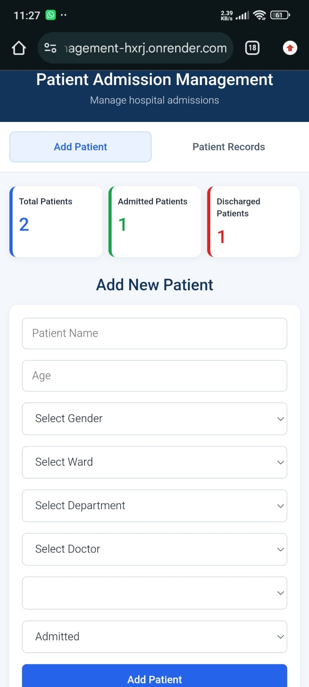
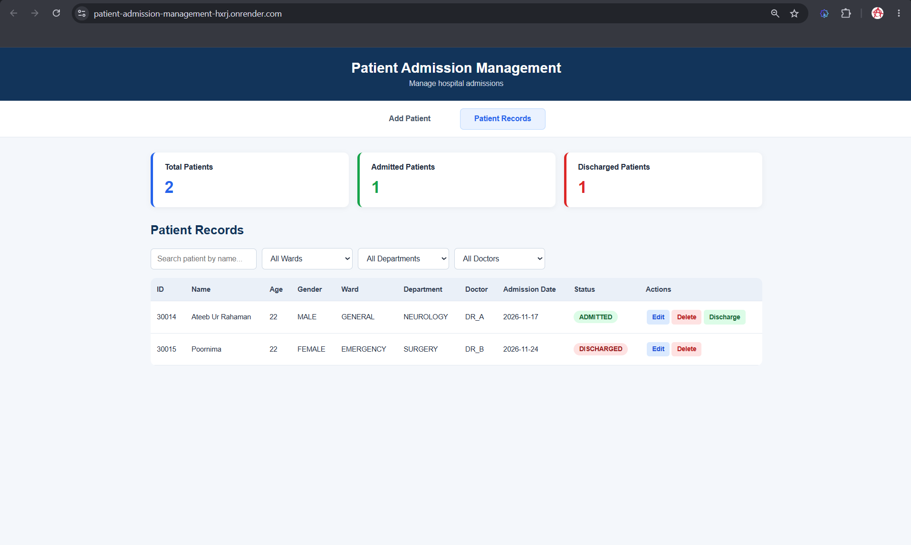
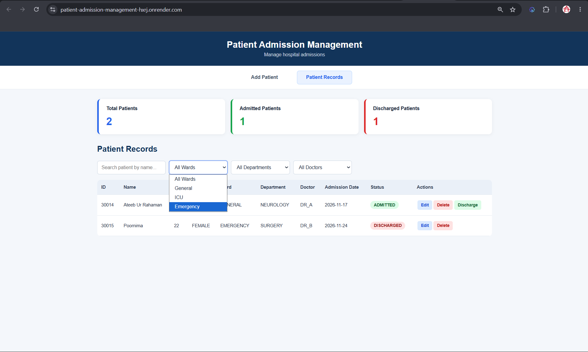
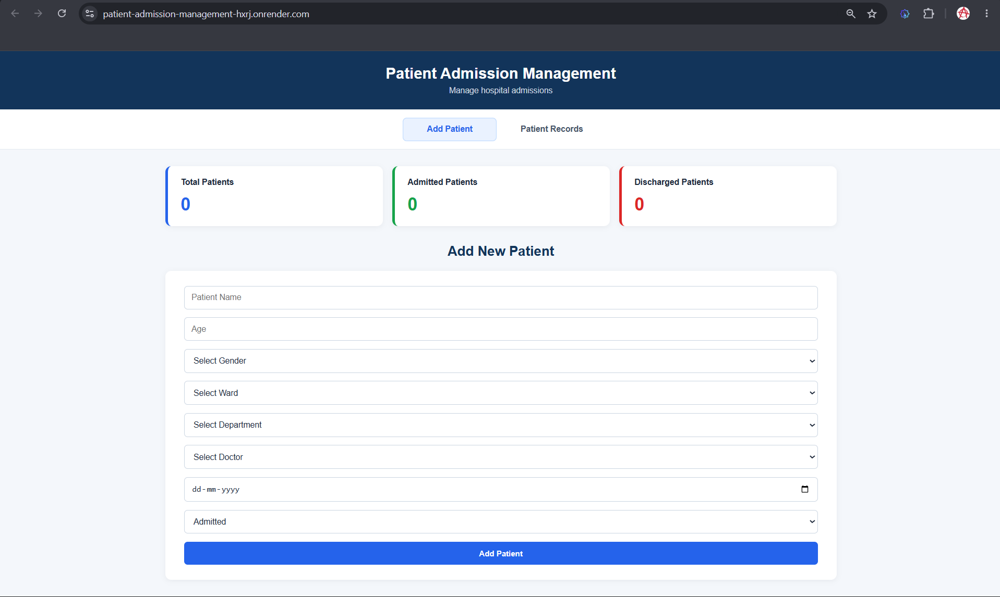

# Patient Admission Management System

A full-stack web application for managing hospital patient admissions. It provides an interface to register patients, view and update patient records, search and filter admissions, and manage patient discharge status.

The application is built using React.js for the frontend, Java and Spring Boot for the backend REST API, and TiDB Cloud for persistent database storage.

## Live Application

| Component | Link |
|---|---|
| Frontend Application | [Open Application](https://patient-admission-management-hxrj.onrender.com) |
| Backend Service | [Backend URL](https://patient-admission-api-iptr.onrender.com) |
| Patients REST API | [View API](https://patient-admission-api-iptr.onrender.com/api/patients) |

## Features

- Register new patients with admission details.
- View all registered patients.
- Search patient records by name.
- Filter records by ward, department, and doctor.
- Update existing patient information.
- Delete patient records with confirmation.
- Mark admitted patients as discharged.
- Display total, admitted, and discharged patient counts.
- Validate patient information on both frontend and backend.
- Responsive interface for desktop and mobile screens.
- Persist patient information in a cloud-hosted database.

## Screenshots

### Mobile View



### Patient Records



### Search and Filters



### Add Patient



## Technology Stack

| Layer | Technologies |
|---|---|
| Frontend | React.js, Vite, JavaScript, CSS |
| Backend | Java 25, Spring Boot 4.2 |
| API | REST API |
| Database | TiDB Cloud (MySQL compatible) |
| ORM | Spring Data JPA, Hibernate |
| Validation | Jakarta Bean Validation |
| Deployment | Render |
| Build Tool | Maven |
| Backend Packaging | Docker |

## Project Structure

```text
patient_admission_management_system/
│
├── frontend/
│   ├── public/
│   ├── src/
│   │   ├── App.jsx
│   │   ├── PatientForm.jsx
│   │   ├── PatientList.jsx
│   │   ├── api.js
│   │   └── ...
│   ├── package.json
│   └── vite.config.js
│
├── src/
│   └── main/
│       ├── java/com/ateeb/patient_admission_management_system/
│       │   ├── config/
│       │   ├── controller/
│       │   ├── dto/
│       │   │   ├── request/
│       │   │   └── response/
│       │   ├── entity/
│       │   ├── enums/
│       │   ├── exception/
│       │   ├── repository/
│       │   └── service/
│       │
│       └── resources/
│           └── application.properties
│
├── certs/
│   └── ca.pem
├── docs/
│   └── screenshots/
│       ├── mobile-view.jpeg
│       ├── patient-records.png
│       ├── search-and-filters.png
│       └── add-patient.png
│
├── Dockerfile
├── settings.xml
├── pom.xml
└── README.md
```

## Patient Information

Each patient record contains:

| Field | Description |
|---|---|
| ID | Unique patient identifier |
| Name | Patient's name |
| Age | Patient's age (0–120) |
| Gender | Male, Female, or Other |
| Ward | General, ICU, or Emergency |
| Department | Cardiology, Neurology, or Surgery |
| Doctor | Assigned doctor |
| Admission Date | Date of admission |
| Patient Status | Admitted or Discharged |

## Backend Architecture

The backend follows a layered architecture to separate request handling, business logic, and database operations.

- **Controller:** Handles incoming HTTP requests and returns API responses.
- **Service:** Contains patient management business logic.
- **Repository:** Performs database operations using Spring Data JPA.
- **Entity:** Represents patient information stored in the database.
- **DTOs:** Separate request and response objects from persistence entities.
- **Exception Handling:** Handles invalid requests and missing patient records with structured error responses.
- **Validation:** Uses Jakarta Bean Validation to validate incoming patient data.

## REST API Endpoints

Base endpoint:

```text
/api/patients
```

| Method | Endpoint | Description |
|---|---|---|
| POST | `/api/patients` | Register a new patient |
| GET | `/api/patients` | Retrieve all patients |
| GET | `/api/patients?name=John` | Filter by patient name |
| GET | `/api/patients?ward=GENERAL` | Filter by ward |
| GET | `/api/patients?department=CARDIOLOGY` | Filter by department |
| GET | `/api/patients?doctor=DR_A` | Filter by doctor |
| PUT | `/api/patients/{id}` | Update patient information |
| DELETE | `/api/patients/{id}` | Delete a patient |
| PATCH | `/api/patients/{id}/discharge` | Mark a patient as discharged |

The GET endpoint supports combining the optional filters.

### Example Patient Request

```json
{
  "name": "John Smith",
  "age": 35,
  "gender": "MALE",
  "ward": "GENERAL",
  "department": "CARDIOLOGY",
  "doctor": "DR_A",
  "admissionDate": "2026-11-25",
  "patientStatus": "ADMITTED"
}
```

### Validation and Error Handling

Patient information is validated before being stored.

- Name is required and must contain only letters and spaces.
- Age is required and must be between 0 and 120.
- Gender, ward, department, doctor, and patient status are required.
- Admission date is required and cannot be in the future.
- Invalid requests are rejected by the backend with structured error responses.
- Requests for non-existent patient records are handled through exception handling.

## Database

The application uses **TiDB Cloud**, a MySQL-compatible cloud database.

Patient records are stored persistently and accessed through Spring Data JPA and Hibernate.

Database credentials and connection details are supplied through environment variables rather than hardcoded into the application source.

## Running Locally

### Prerequisites

- Java 25
- Maven
- Node.js and npm
- MySQL-compatible database

### 1. Clone the Repository

```bash
git clone https://github.com/ateeburrahaman3/patient-admission-management.git
cd patient-admission-management
```

### 2. Configure Backend Environment Variables

The backend uses the following environment variables:

| Variable | Description |
|---|---|
| `DB_URL` | Database JDBC connection URL |
| `DB_USERNAME` | Database username |
| `DB_PASSWORD` | Database password |
| `FRONTEND_URL` | Frontend origin allowed by CORS |
| `PORT` | Server port; defaults to 8080 |

Example using PowerShell:

```powershell
$env:DB_URL="jdbc:mysql://localhost:3306/patient_admission_db"
$env:DB_USERNAME="root"
$env:DB_PASSWORD="your_password"
$env:FRONTEND_URL="http://localhost:5173"
```

Use your own database name and credentials.

### 3. Start the Backend

From the project root:

```bash
mvn spring-boot:run
```

Backend address:

```text
http://localhost:8080
```

Patients API:

```text
http://localhost:8080/api/patients
```

### 4. Configure and Start the Frontend

Open another terminal:

```bash
cd frontend
npm install
```

Create a `.env.local` file inside the `frontend` directory:

```env
VITE_API_BASE_URL=http://localhost:8080
```

Start the frontend:

```bash
npm run dev
```

Frontend address:

```text
http://localhost:5173
```

## Deployment

The application is deployed using **Render**, with **TiDB Cloud** providing persistent database storage.

### Deployment Architecture

```text
                 User Browser
                      |
                      v
           React Frontend (Render)
                      |
                REST API Calls
                      |
                      v
        Spring Boot Backend (Render)
               Docker Web Service
                      |
                Spring Data JPA
                      |
                      v
             TiDB Cloud Database
```

### 1. Database Deployment – TiDB Cloud

- Create a TiDB Cloud database cluster.
- Obtain the database connection URL, username, and password.
- Configure the connection using the backend environment variables.
- Use the TiDB CA certificate for secure database connectivity.

### 2. Backend Deployment – Render

- Connect the GitHub repository to Render.
- Create a new **Web Service** using the Docker runtime.
- Configure the project root as the service's build context so Render can access the root `Dockerfile`, Maven files, source code, and certificate.
- Configure the required environment variables:

| Variable | Purpose |
|---|---|
| `DB_URL` | TiDB Cloud JDBC connection URL |
| `DB_USERNAME` | TiDB database username |
| `DB_PASSWORD` | TiDB database password |
| `FRONTEND_URL` | Deployed frontend URL |

- Deploy the backend using the Dockerfile.

The Dockerfile builds the Spring Boot application using Maven and Java 25, then runs the packaged application using a Java 25 runtime. It also imports the TiDB CA certificate into the Java truststore.

### 3. Frontend Deployment – Render

- Create a new **Static Site** on Render.
- Connect the same GitHub repository.
- Set the root directory to `frontend`.
- Configure the build command:

```bash
npm install && npm run build
```

- Set the publish directory:

```text
dist
```

- Add the frontend environment variable:

```env
VITE_API_BASE_URL=https://patient-admission-api-iptr.onrender.com
```

- Deploy the frontend.

### 4. Connect Frontend and Backend

The frontend uses `VITE_API_BASE_URL` to communicate with the deployed backend.

The backend uses `FRONTEND_URL` to configure CORS and allow requests from the deployed frontend.

After deployment, the frontend communicates with the backend API, which reads and writes patient records in TiDB Cloud.

### 5. Deployment Verification

After deployment, verify that:

- The frontend application loads successfully.
- The backend API responds at `/api/patients`.
- Patient records can be retrieved from the database.
- New patient records can be created and persisted.
- Updates, deletion, and discharge operations work correctly.

## Environment and Security Notes

- Database credentials are supplied through environment variables.
- The frontend API URL is configured through a Vite environment variable.
- The backend CORS configuration uses the configured frontend origin.
- The TiDB CA certificate is imported into the backend Docker image's Java truststore.
- Do not commit actual database credentials or private environment files to GitHub.

## Author

**Ateeb Ur Rahaman**

GitHub: [ateeburrahaman3](https://github.com/ateeburrahaman3)